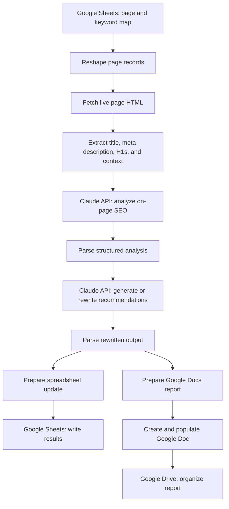

# AI-Assisted On-Page SEO Automation with n8n

A portfolio overview of an n8n workflow that combines live-page inspection, keyword mapping, AI-assisted on-page recommendations, spreadsheet updates, and Google Docs reporting.

> **Public portfolio version:** This repository intentionally documents the architecture rather than including the production n8n export. The production export contains private Google Sheets/Drive identifiers and detailed prompt/workflow logic that should not be published without a deliberate IP-sharing decision.

## What it does

The workflow is designed to help an SEO specialist process mapped website pages in a repeatable workflow:

1. Read page and keyword-mapping data from Google Sheets.
2. Fetch each page's live HTML.
3. Extract current HTML title, meta description, H1 headings, and supporting page context.
4. Use Claude API calls for SEO analysis and suggested on-page rewrites.
5. Parse model responses and prepare structured output fields.
6. Update the output spreadsheet and generate a Google Docs report, then organize the document in Google Drive.

The exact recommendations depend on the input data, site implementation, prompts, and connected services. AI output should be reviewed by an SEO professional before being published.

## Workflow architecture

## Integrations

- **n8n** for workflow orchestration
- **Google Sheets** for page/keyword inputs and structured outputs
- **HTTP Request** nodes for retrieving page HTML and calling the model API
- **Anthropic Claude API** for AI-assisted analysis and rewriting
- **Google Docs and Google Drive** for report generation and organization

## Input data

The production workflow expects a Google Sheet with page URLs and keyword mapping fields. The current workflow uses fields in this general shape:

| Field | Purpose |
|---|---|
| `page_url` | URL of the page to analyze |
| `page_title` | Human-readable page label/title |
| `primary_keyword` | Main target keyword |
| `primary_volume` / `primary_competition` | Optional keyword metrics |
| `secondary_keyword_1...` | Additional target keywords |
| `sec_vol_1...` / `sec_comp_1...` | Optional secondary keyword metrics |
| `lsi_keyword_1...` | Related/contextual keywords |
| `lsi_vol_1...` / `lsi_comp_1...` | Optional related keyword metrics |

Use the precise field names expected by your configured workflow when setting up your own copy.

## Output examples

Depending on the input and workflow configuration, results can include:

- Existing title tag, meta description, and H1 information
- Suggested H1, title tag, and meta description
- Character-length checks for generated tags
- Keyword coverage and content recommendations
- Internal-linking suggestions for further review
- A Google Docs report for a page

These are workflow capabilities, not a guarantee that every output will be correct for every site. Review suggestions for factual accuracy, search intent, brand voice, technical feasibility, and compliance before implementation.

## Setup overview

A working deployment requires your own n8n environment and credentials for Google Sheets, Google Docs, Google Drive, and the Claude API. Use your own test spreadsheet and Drive folder. Configure credentials in n8n's credential manager rather than placing secrets in node parameters or files.

This repository does **not** contain an import-ready production workflow. The production workflow was intentionally kept out of the public portfolio copy to avoid exposing internal prompt logic and private document identifiers.

## Security and limitations

- Never commit API keys, OAuth tokens, credentials, client data, private spreadsheet IDs, Drive folder IDs, or confidential URLs.
- Test with pages and data you are authorized to access.
- HTML fetched over HTTP may not include content rendered only by JavaScript; compare with the rendered page when necessary.
- AI-generated recommendations are drafts, not automatic authorization to change a live page.
- Validate title/meta lengths, schema, internal links, and claims before publishing.
- The workflow export has not been independently executed as part of preparing this portfolio overview; runtime behavior depends on your n8n version, credentials, APIs, and sheet structure.

## About

Built as part of practical technical SEO and workflow-automation work. This repository is intended to explain the workflow's purpose and architecture to prospective collaborators and clients.

- Website: [sandeepgoel.me](https://sandeepgoel.me/)
- LinkedIn: [Sandeep Goel](https://www.linkedin.com/in/sandeepgoel-ai-seo-expert/)

## Documentation

- [Workflow Summary](docs/workflow-summary.md): Overview of the automation stages and integrations.
- [Setup and Security Checklist](docs/setup-and-security.md): Prerequisites, configuration guidance, security measures, and deployment validation.
